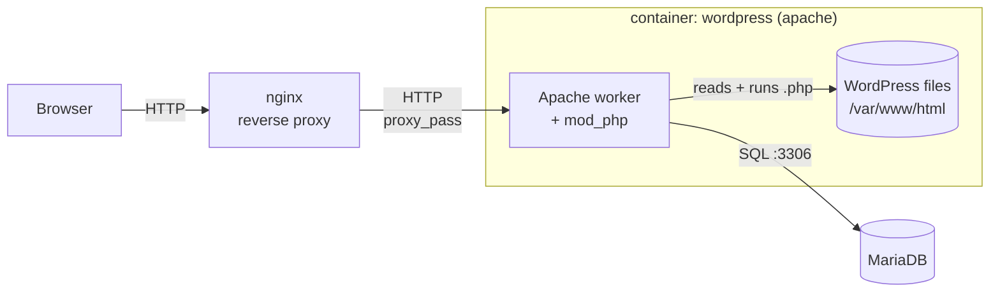
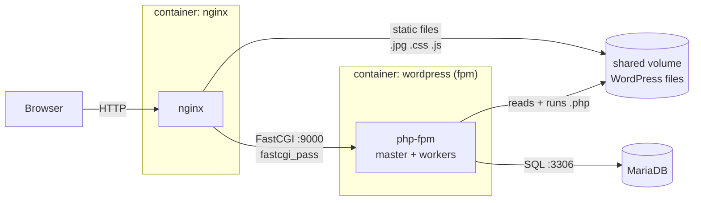

# Liftoff
- From an empty VM to a live site in one run.

# Architecture: how PHP runs

WordPress is only `.php` files. A PHP interpreter runs them, and a web server speaks HTTP with the browser.

## `wordpress:*-apache`: Apache + mod_php

The PHP interpreter is a module **inside** Apache: one process is both the web server and the interpreter.
nginx forwards everything over HTTP.

## `wordpress:*-fpm`: nginx + FastCGI + php-fpm

php-fpm is a PHP interpreter that runs **on its own** and waits on port 9000.
nginx sends `.php` requests to it with the FastCGI protocol, and serves static files (images, CSS, JS) itself,
so both containers need the WordPress files (a shared volume).

# References

## Ansible
- [YAML syntax](https://docs.ansible.com/projects/ansible/latest/reference_appendices/YAMLSyntax.html#yaml-syntax)
- [Using variables](https://docs.ansible.com/projects/ansible/latest/playbook_guide/playbooks_variables.html)
- [Facts and magic variables](https://docs.ansible.com/projects/ansible/latest/playbook_guide/playbooks_vars_facts.html)
- [Special variables](https://docs.ansible.com/projects/ansible/latest/reference_appendices/special_variables.html#special-variables)
- [Roles](https://docs.ansible.com/projects/ansible/latest/playbook_guide/playbooks_reuse_roles.html)
- [Collection index (modules)](https://docs.ansible.com/projects/ansible/latest/collections/ansible/index.html)
- [Jinja built-in filters](https://jinja.palletsprojects.com/en/stable/templates/#builtin-filters)

## Docker
- [Install Docker Engine on Ubuntu (apt repository)](https://docs.docker.com/engine/install/ubuntu/#install-using-the-repository)

## MariaDB
- [Official Docker image](https://hub.docker.com/_/mariadb)
- [Healthcheck without mysqladmin](https://mariadb.org/mariadb-server-docker-official-images-healthcheck-without-mysqladmin/)
- [Using healthcheck.sh](https://mariadb.com/docs/server/server-management/automated-mariadb-deployment-and-administration/docker-and-mariadb/using-healthcheck-sh)

## WordPress
- [Server requirements](https://wordpress.org/about/requirements/)
- [Official Docker image](https://hub.docker.com/_/wordpress)
- https://developer.wordpress.org/advanced-administration/wordpress/wp-config/#wp-siteurl

## Nginx
- [Beginner’s Guide](https://nginx.org/en/docs/beginners_guide.html)
- https://hub.docker.com/_/nginx
